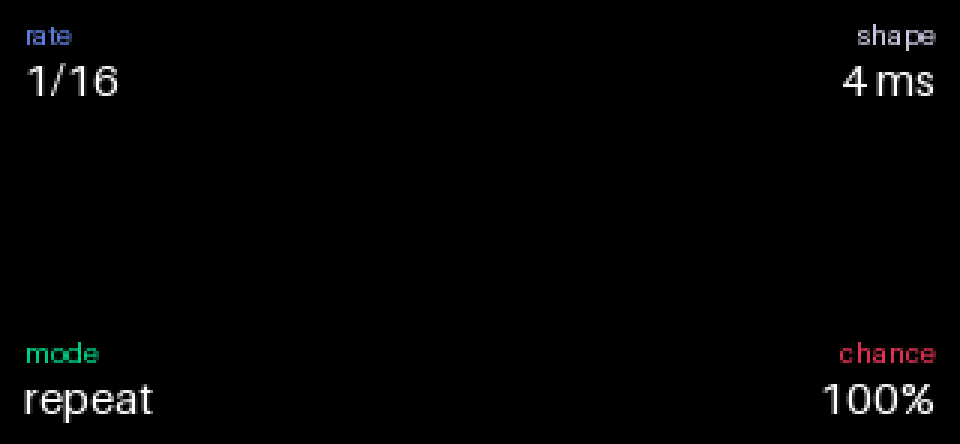
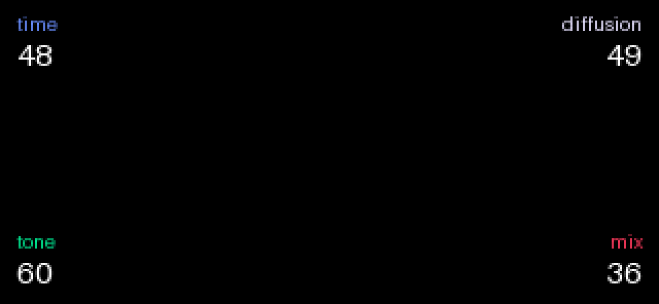

# Studder-and-Reverb-port-to-Opus

Native Opus .opmod ports of Hundekraft’s Reverb and STUTTER effects for the original Teenage Engineering OP-1,
preserving their signature DSP, controls, and performance with efficient, standalone plugins.

Two independent [Opus 2](https://github.com/LizardMan245/opus) plugins for the **original OP-1 on firmware 246**:

| File | Plugin id | Effect in the OS's list | What |
|---|---|---|---|
| `sammi.reverb.opmod` | `sammi.reverb` | `hkreverb` | Hundekraft's Reverb: the Mutable Instruments Elements tank in fixed point |
| `sammi.stutter.opmod` | `sammi.stutter` | `hkstutter` | Hundekraft's STUTTER: a beat-locked stutter with repeat, brake, reverse and gate |

Both are **native Opus effect types**, registered with the core's effect service. They are not renamed `.knl` or
`.op1p` files, and they need neither opus.bridge nor any other plugin. Each is built with the Opus plugin kit. They
work wherever Opus runs effects: the synth's slot, the drum's, the master, and Opus managers such as overdrive's
second effect.

The sound is Hundekraft's, unchanged. The ports reuse the original DSP code; only the parts Opus needs differently
change ([docs/MODIFICATIONS.md](docs/MODIFICATIONS.md)). Their output is **bit-identical** to Hundekraft's originals
in every test scenario, on a PC and as compiled Blackfin code in a simulator.

## Status: what has and has not been done

| Stage | Status |
|---|---|
| Built and linked with the Opus plugin kit (`plugin_tool.py build`, warnings are errors), read back with `show` | **done** |
| Host tests under AddressSanitizer + UndefinedBehaviorSanitizer: output against Hundekraft's original files, byte for byte (4.1 MB reverb, 11.4 MB STUTTER of scenarios) | **pass** |
| Port checks: registration, the page, the shift layer, shared memory, silence, every STUTTER rate × mode × repeat count sample by sample (5,255 + 5,642 checks) | **pass** |
| The reverb's decay, tone, diffusion, wet/dry and stereo measured | **pass** |
| The compiled Blackfin code (the kit's flags) in the Blackfin instruction-set simulator: output against the originals, byte for byte | **pass** |
| CPU | **simulator figures and an estimate; not measured on a device** |
| Opus emulator | **not done**: the kit's emulator is not released yet |
| **Tested on an OP-1** | **not done** |

A clean build and passing tests mean the code is right as far as a computer can tell. They don't mean it works on
the instrument: the install, the effect pages and the real CPU load are untried. Details:
[docs/TESTING.md](docs/TESTING.md).

## Download and install

The files are in [`release/`](release/):
- `sammi.reverb.opmod` and `sammi.stutter.opmod`;
- `SHA256SUMS.txt`;
- `sammi-reverb-stutter-1.1.0.zip`, which holds both plugins, the install note, the docs, the licences, the test
  results and the complete source.

You need an original OP-1 (not the OP-1 field) on firmware 246 with **Opus 2** installed. The Opus site's patcher
makes the update from your own `op1_246.op1`. Both plugins need **core 2.2** or later (the plugin kit used here documents cores up to 2.13).
These steps follow the plugin kit's `docs/getting-started.md`. The Opus website itself could not be reached from the
machine this was built on.

1. **Developer mode** (for the first tries): open Opus's menu (hold **synth + drum + tape + mixer**), **T1**, switch
   **developer mode** on. A plugin that crashes is then not left out at the next start, and one that uses too much
   CPU is not switched off. Switch it off when you're done.
2. **Disk mode:** **shift + COM**, then **T3**, and connect the OP-1.
3. Copy `sammi.reverb.opmod` and/or `sammi.stutter.opmod` into the disk's **mods** folder. Each one is independent.
4. Eject, then switch the OP-1 off and on.
5. Opus's menu, **T2** (the mods list): each row should say **loaded**.
6. On the synth, the drum or the master, choose **hkreverb** or **hkstutter** in the effect list. **T3** switches it
   on and off.

If something goes wrong:
- a plugin that crashes is left out at the next start ("skipped: crashed");
- holding **Stop** while switching on starts the OP-1 with no plugins; then delete the file in disk mode;
- Opus never touches te-boot, the OP-1's own recovery.

## The controls

Every name, range and default here comes from Hundekraft's source. Full details: [docs/CONTROLS.md](docs/CONTROLS.md).

**hkreverb**

| Encoder | Turn |
|---|---|
| 🔵 blue | **time**: the decay, loop gain 0.35 → 0.98 |
| 🟢 green | **tone**: the loop's low-pass, dark → bright |
| ⚪ white | **diffusion**: the allpasses, 0.5 → 0.75 |
| 🟠 orange | **mix**: dry → wet |

The page shows the four values (0–99) and **the endless mirror**, a tunnel lit by the tail's own level. On the master, the tank hears (L + R) / 2 and its
reverb goes in the middle; the dry stereo image is kept, as on kennel.

**hkstutter**

| Encoder | Turn | Shift + turn |
|---|---|---|
| 🔵 blue | **rate**: 1/4, 1/8, 1/8t, 1/16, 1/16t, 1/32 of a beat | **REPEATS**: 2, 3, 4, 6, 8, 16 parts, round and round (saved with the sound) |
| 🟢 green | **mode**: repeat, brake (a tape stop), reverse, gate | the OS's fine step |
| ⚪ white | **shape**: 2–12 ms fades; in gate, the open time 10–90 % | the OS's fine step |
| 🟠 orange | **chance**: how many slices stutter | **FREEZE**: clockwise on, anticlockwise off (per slot, not saved) |

The page shows rate, mode, shape and chance, and **the defective tape head**: the timeline pinching into the head
and the fragment shaking in its box, once per repeat, as the DSP plays it.

The grid follows the OP-1's tempo (BPM or MIDI clock) and the tape's speed while the clock follows the tape. With no
clock it runs on at 120 BPM.

**What changed from kennel:** REPEATS (blue push, page 2) and FREEZE (orange push) are on shift + blue and
shift + orange here. An Opus effect type has a shift layer but no encoder-press handler. Both are declared in the
manifest as `modal`, so they never clash with another plugin.

## The pages (1.1.0)

| STUTTER: the defective tape head | REVERB: the endless mirror |
|---|---|
|  |  |

- **Drawn from what the DSP is doing:** STUTTER from its slice, part, mode and read position; REVERB from the input's
  and the tank's own levels. The encoders' colours mark what each encoder drives.
- **Switched off (T3):** the OS's own "off" overlay dims the pictures exactly as it dims a stock effect's page,
  because they are drawn on the stock effects' layer, under the OS's screen. No guessing at the state is involved.
- **Details:** the states, the colour mapping, the off behaviour, the cost and what the previews are:
  [docs/VISUALS.md](docs/VISUALS.md). The previews were rendered on a PC from the plugins' own code, not captured on
  an OP-1.

## CPU and memory

| | Simulator, worst block (mono / master) | Estimated on a device | Memory (OS slots) |
|---|---|---|---|
| hkreverb | 15,004 / 17,808 cycles | ~25–30k (4–5 % of the block) | ~174 KB + 3 KB image |
| hkstutter | 12,762 / 15,557 cycles (init: 32,868, the ring clear) | ~14–17k | ~262 KB + 6 KB image |

- The simulator doesn't model the OP-1's SDRAM cache misses; the estimates add them, by the kit's own rule of thumb.
- The pages: the plugins' own drawing code costs about 1.1–2.3k cycles a frame in the display thread, plus the core's
  renderer for at most 154 (REVERB) and 89 (STUTTER) primitives.
- Neither plugin has a measured `cpu.txt` yet, so the core holds each to a tenth of the audio block (58,052 cycles).
- How to measure on your OP-1 and record it: [docs/TESTING.md](docs/TESTING.md#5-8-and-9-the-compiled-code-in-the-blackfin-simulator-testsbfin_simrunsh).

## Known limitations

- **Untested on hardware** (see the status table). A `checked device` line goes into each manifest only after it has
  run on an OP-1.
- **STUTTER reads firmware memory directly (read only).** Opus 2 has no tempo service, so it reads the stock
  metronome's beat clock and the tape speed at firmware 246's addresses, exactly as kennel does.
- **Neither effect is true stereo, as on kennel.** Both originals are mono; on the master they process (L + R) / 2,
  and their change is added to both sides.
- **Reverb, at the very top of time:** the original keeps a tiny idle residue at some tone settings: ±8 LSB, about
  −72 dBFS, bounded and not growing. Its tail there runs for up to about 85 s. The port keeps it, bit for bit.
- **The pages' pictures are new** (Hundekraft's artwork is not used) and have not been seen on an OP-1's display:
  their place beside the core's corner text is kept clear by design (x 88–232, y 14–134), not by a device check.
- **Effect names `hkreverb` / `hkstutter`.** These differ from the names opus.bridge gives Hundekraft's own effects
  (`reverb` / `stutter`), so both can be loaded at once. A sound saved with Hundekraft's own effect still loads
  through the bridge, not these plugins.
- **The OS's effect path rate:** kennel's notes say the mono effect path may run below 44.1 kHz. The port runs on the
  same path, so it sounds as the original does, whatever the rate.
- **STUTTER's ring clear:** it runs at init (when the effect is chosen, or a sound, slot or instrument changes). It
  clears 128 KB at once, as kennel does.

## Building and testing

[docs/BUILDING.md](docs/BUILDING.md). In short, with the Opus kit, Hundekraft's 3.1.1 source, a `bfin-elf-gcc` 13.3
toolchain and the Blackfin simulator, both from the shared `~/mnt/Documents/op1-toolchain` (this repository does not build them):

```sh
. ~/mnt/Documents/op1-toolchain/env.sh
sh tools/release.sh     # host tests, simulator tests, the .opmod build, results/, release/
```

## Licence and credits

GPL-3.0-or-later with the additional permission to combine it with the OP-1 firmware: [LICENSE](LICENSE),
[NOTICE](NOTICE), [NOTICE.kennel](NOTICE.kennel).

- **The effects:** Hundekraft ([OP-1 Workshop](https://github.com/Hundekraft/op1-workshop), kennel 3.1.1); kennel
  is based on pcppcp's op1r-src.
- **The reverb's algorithm:** the Mutable Instruments Elements reverb, © 2014 Emilie Gillet, MIT
  ([LICENSE.elements](LICENSE.elements)).
- **Opus 2 and its plugin kit:** LizardMan.
- **The toolchain scripts and simulator start-up:** Project_Hollow_Saint.
- **This port, its pages and its tests:** sammi.

The originals are kept unchanged in [`third_party/`](third_party/). What was changed and why:
[docs/MODIFICATIONS.md](docs/MODIFICATIONS.md).

No Teenage Engineering firmware, firmware image, device key, font or artwork is included. This project is not
affiliated with or endorsed by Teenage Engineering, Hundekraft or LizardMan. OP-1 is a trademark of Teenage
Engineering AB.
