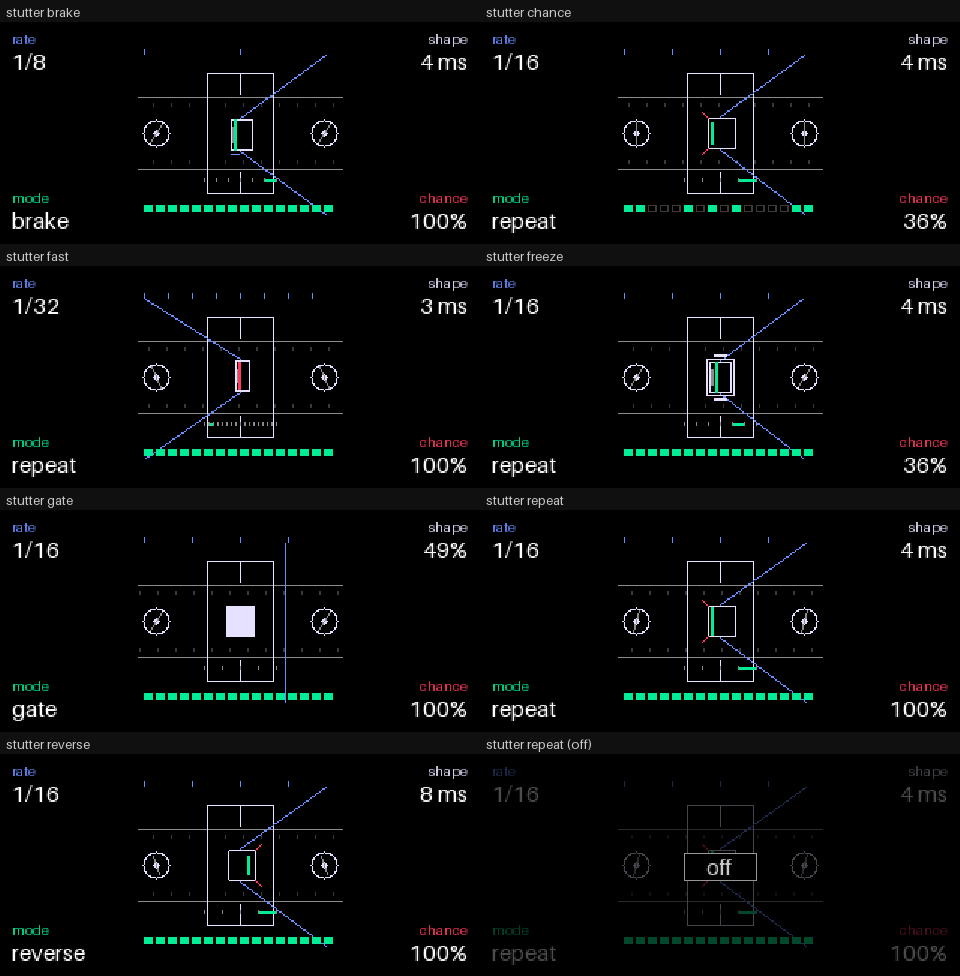
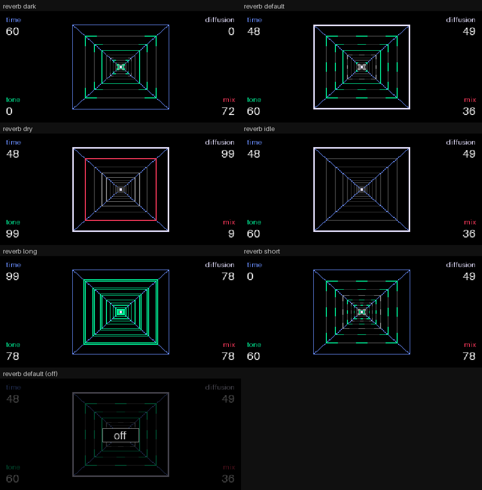

# The pages: the defective tape head and the endless mirror (1.1.0)

Each effect's page now has a picture of its own in the middle. The core still draws the four values in the corners,
in the encoders' colours, as on every Opus effect page. The pictures are drawn from what the effect is actually
doing, never from a timer of their own:
- **STUTTER** draws its slice, part, mode, read position and freeze, as the audio left them after each block.
- **REVERB** draws the input's level and the tank's own level, plus the page's four parameters.

Previews (rendered on a PC by the plugins' own drawing and audio code; see "What the previews are" below):

| | |
|---|---|
|  |  |

Animated: [repeat](media/stutter_repeat.gif), [brake](media/stutter_brake.gif), [reverse](media/stutter_reverse.gif),
[gate](media/stutter_gate.gif), [1/32 with 16 parts](media/stutter_fast.gif), [freeze](media/stutter_freeze.gif),
[chance 36 %](media/stutter_chance.gif); [reverb default](media/reverb_default.gif), [long](media/reverb_long.gif),
[short](media/reverb_short.gif), [dark](media/reverb_dark.gif), [dry](media/reverb_dry.gif), [idle](media/reverb_idle.gif).

## The colours

The four colours are the encoders' own (`OPUS_COLOR_E1`–`E4`), so they follow the user's theme as the stock pages
do. Each colour stands for the encoder that drives that part of the picture:

| | STUTTER (blue rate, green mode, white shape, orange chance) | REVERB (blue time, green tone, white diffusion, orange mix) |
|---|---|---|
| **blue** | the playback position: the timeline, the rate's grid of slices above, BRAKE's speed bar | the tunnel's structure: the rails to the horizon, the mouth while the wet leads |
| **green** | the fragment and the repetition: the trapped piece, the part playing on the ruler, the slices that stuttered | the reflections: the tail's level travelling inward |
| **white** | the machine: the head, the rollers, the fragment's box (soft corners with a soft shape), FREEZE's clamps | the horizon point, and the mouth while the dry leads |
| **orange** | destructive events: the catch at each repeat's start (on the right in REVERSE), the fragment itself at 8 and 16 parts | the dry signal entering: an onset's frame travelling in, the mouth on loud input |

Grey (`OPUS_COLOR_DIM`, `OPUS_COLOR_OFF`) is for the passive parts: the tape, the unlit depths, the ruler's ticks.
There are no gradients and no text in the picture.

## STUTTER: the defective tape head

A top-down tape transport: the tape crosses the screen between two rollers and under the head.

| State (the DSP's) | What it looks like |
|---|---|
| a slice playing through | the blue timeline sweeps across the beat; the tape and rollers run; the rate's slices tick above |
| a stuttering slice's first part | the box opens in the head gap, and a green bar fills it as the part is recorded |
| its repeats: **REPEAT** | the timeline pinches into the head; the green fragment shakes left to right in its box, once per repeat; orange sparks at each catch; the tape stops |
| **BRAKE** | the fragment's sweep slows with each repeat (the read position the DSP uses); a blue bar under the box shrinks with the playback speed; the tape slows |
| **REVERSE** | the fragment sweeps right to left; the sparks fly off the right side; the tape runs backwards |
| **GATE** | the timeline isn't pinched (the sound is live); the box is a shutter, open (green stripes) while the gate is open, shut (white) while closed |
| **REPEATS** (shift + blue) | the box shrinks as the parts get shorter; the ruler under the head has one tick per part, the playing part lit green; at 8 and 16 parts the fragment turns orange and leaves a grey ghost |
| **FREEZE** (shift + orange) | the box is clamped (a double outline, bars above and below) and the tape stands still |
| **chance** | the row along the bottom is the last 16 slices: green stuttered, grey outline played through |
| **shape** | the fragment's height follows the repeat's own fade in and out; a soft shape (over half) rounds the box's corners |

The box shakes by a unit, abruptly, on each part. Nothing moves that the DSP is not doing.

## REVERB: the endless mirror

Eleven nested frames shrink by 0.74 each into a white horizon point, and four blue rails run from the mouth into the
depth.

| State | What it looks like |
|---|---|
| silence | the stable tunnel: unlit grey frames, blue rails, the white horizon point |
| input | an onset sends one frame in: orange at the mouth, green as it goes deeper; a short **time** sends it faster |
| the tail | each frame shows the tank's level as it was one frame earlier than the frame before it, in four steps (green, grey, dark grey, unlit). The reflections recede inward and fade as the tail dies |
| **time** | the tail's own length decides how long the reflections stay lit: a long time keeps the tunnel glowing, a short one drains it |
| **tone** | the reflections' density: whole outlines when bright, dashes in between, corners only when dark |
| **diffusion** | the spread: the strong near reflections double into a smeared outline (by 1 or 2 units) |
| **mix** | the weight between foreground and depth: under half (dry-led) the mouth is white and doubled, over half it's blue; under a quarter the reflections are one step dimmer, over three quarters one step brighter |

The horizon point grows a white ring while the tail is strong.

## Switched off: as a native effect

Opus doesn't hand an effect its on/off state, so the plugins don't need it.
- **Native effects:** when you switch an effect off (T3), the OS draws its own "off" overlay over the effect page
  (`fx_bypass.cpp`: the whole frame dimmed, and the "X off" / "H off" / "I off" badge). Opus documents this for plugin
  types too: "the OS's own 'off' overlay covers the page".
- **These pictures:** they are drawn under the OS's screen (`opus_on_frame_under`, the layer Opus documents as "the
  same layer as the stock effects"). So the overlay dims them exactly as it dims a stock effect: the same colours,
  the same contrast, the same badge, at once, and restored at once when the effect goes back on.
- **Nothing is inferred** from output volume or parameters. When the OS stops calling the effect's audio, its state
  stops changing: STUTTER's machine stands still and REVERB's reflections drain to the stable tunnel. The host tests
  check that both pictures are perfectly still once no audio block runs.

What could not be done:
- Opus offers no on/off flag for the synth and drum slots. The firmware's master flag is documented, but using it for
  one slot only would be inconsistent; kennel reaches the synth's through an undocumented firmware call. So the pages
  don't read the flag. They rely on the native overlay, as the stock effects' pages do.
- Whether the OS stops calling an effect's audio while it's off couldn't be confirmed without an OP-1. If it still
  calls it, the picture keeps moving under the overlay, dimmed, as a stock page's own animation would.

## How it is drawn, and its cost

- **Page detection:** the picture draws only while the plugin's own page shows. That means an effect page is up
  (`opus_fx_page_shown`), the plugin's `view` ran in the last two frames, and it ran for the same owner
  (`opus_fx_owner`). So it never draws under another type's page or the effect list.
- **Primitives:** only the core's page calls (`opus_page_fill`, `frame`, `line`, `dot`, `opus_sincos`). There are no
  allocations, no files and no art files.
  - STUTTER: at most 89 primitives a frame.
  - REVERB: at most 154.
- **Cost:** the plugin's own drawing code costs 1,100–1,500 (REVERB) and 1,700–2,300 (STUTTER) cycles a frame in the
  Blackfin simulator. The core's renderer then draws the primitives; that cost isn't measured.
- **The audio side:** the effect publishes a few words per block for the page. REVERB adds about 320 cycles per
  block (the input's peak), STUTTER about 30. The sound is unchanged, byte for byte (the tests).
- **Core:** needs core 2.2 (`opus_fx_owner`, `opus_fx_page_shown`, `opus_instrument_now`: the managers' service).
  1.0.0's STUTTER already called two of these while its manifest said 2.0; 1.1.0 corrects that.

## What the previews are

The previews come from `tests/host/preview.c` + `preview.py`.
- **The plugin's own:** the picture in the middle is the plugins' own drawing code, run on a PC with their own audio
  code on a real input (chords with a click on each beat, 120 BPM). It goes through a stand-in rasteriser one unit to
  one pixel, without the OS's line smoothing.
- **Stand-ins:** the corner text approximates the core's page; the core's real font and places differ. The "off" cells
  simulate the OS's overlay.
- **Not a capture:** none of this was captured on an OP-1. Where exactly the core puts its corner text is not
  documented, so the picture keeps to x 88–232, y 14–134 (checked by the tests). Check that the corners stay clear on
  the device.
